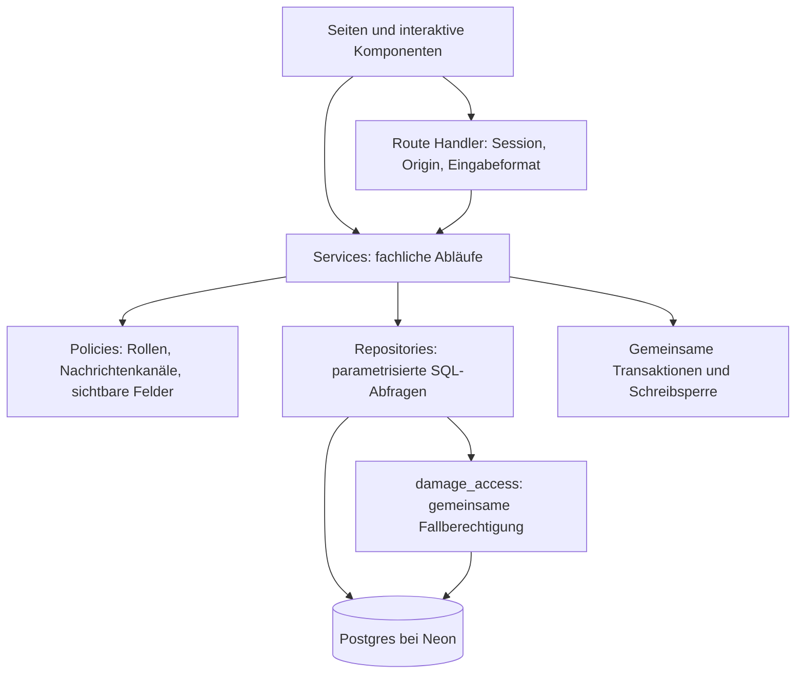
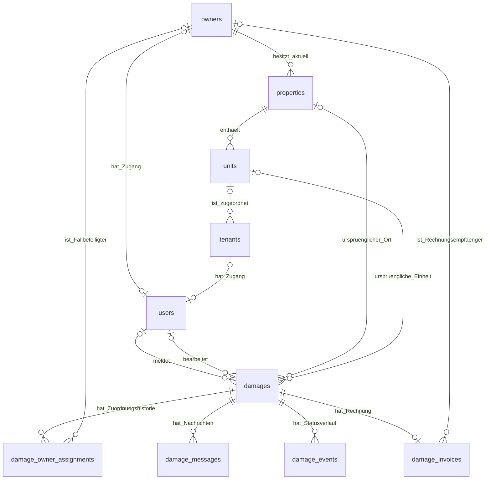

# Datenmodell und Zugriffsschichten

Stand: 6. November 2026. Dieses Dokument beschreibt die Implementierung ab den Migrationen 005 und 006. Es ist technische Projektdokumentation und kein Text für die Benutzeroberfläche.

## Ergebnis der Bestandsprüfung

Die Prüfung umfasste alle Anwendungstabellen, Fremdschlüssel, Migrationen, SQL-Abfragen, API-Routen und die Anbindung von Neon Auth. Vor dem Umbau wurden 14 Anwendungstabellen einschließlich technischer Tabellen untersucht. Die bestehenden vier Migrationen stimmen mit ihren gespeicherten Prüfsummen überein. Die geprüften Auth-, Rollen-, Wohnungs-, Status- und Rechnungsbeziehungen enthielten keine widersprüchlichen Datensätze.

Die wesentlichen Architekturprobleme waren:

| Befund                                                                                                                                 | Änderung                                                                                                                                |
| -------------------------------------------------------------------------------------------------------------------------------------- | --------------------------------------------------------------------------------------------------------------------------------------- |
| Fallzugriff wurde in Listen in SQL und bei einzelnen Fällen in TypeScript getrennt geprüft.                                            | Eine zentrale Datenbanksicht `damage_access` wird von allen Fallabfragen verwendet.                                                     |
| Der Eigentümer eines offenen Falls wurde bei jedem Lesen aus dem Gebäude abgeleitet.                                                   | Fälle erhalten eine eigene, historisierte Eigentümerzuordnung. Ein Gebäudewechsel überträgt keinen bestehenden Fall.                    |
| Der Zugriff wechselte bei Rechnungsstellung auf einen anderen indirekten Beziehungspfad.                                               | Der Rechnungsempfänger muss zur bestehenden Fallzuordnung passen. Der abgerechnete Fall wird nicht einem anderen Eigentümer übertragen. |
| Die effektive Mieteradresse wurde mehrfach mit derselben JOIN-Logik berechnet.                                                         | Die Sicht `tenant_assignments` und das Housing-Repository werden gemeinsam verwendet.                                                   |
| Eine Portalseite führte selbst SQL aus; Servicefunktionen mischten SQL und Geschäftsabläufe.                                           | Seiten rufen Services auf; SQL liegt in Repositories.                                                                                   |
| Stammdatenänderungen schrieben jeden Datensatz erneut und löschten nach einer negativen Gesamtliste.                                   | Der Server ermittelt Änderungen und schreibt nur neue, geänderte und ausdrücklich entfernte Datensätze.                                 |
| Rollen und Kontaktverweise konnten auf Datenbankebene widersprüchlich kombiniert werden.                                               | CHECK-Constraints erzwingen passende Benutzer- und Einladungszuordnungen.                                                               |
| Eine Einheit konnte nachträglich in ein anderes Gebäude verschoben werden, obwohl ein Fall auf die ursprüngliche Kombination verweist. | Serviceprüfung und zusammengesetzter Fremdschlüssel verhindern diese Inkonsistenz.                                                      |
| Statusereignisse enthielten keinen handelnden Nutzer.                                                                                  | Neue Ereignisse speichern Nutzer-ID und Namensstand. Ältere Ereignisse bleiben ohne erfundenen Autor.                                   |

## Schichten



- **UI:** stellt Daten dar, sammelt Eingaben und führt Suche bzw. Navigation aus. Sie erteilt keine Berechtigungen.
- **HTTP-Schicht:** prüft Session, Herkunft der Schreibanfrage und Eingabeformat. Sie übersetzt fachliche Fehler in HTTP-Antworten.
- **Services:** führen Anwendungsfälle aus, beispielsweise Fall melden, Fall übernehmen, Eigentümer zuordnen oder Rechnung erstellen. Sie steuern Transaktionen und fachliche Voraussetzungen.
- **Policies:** enthalten wiederverwendbare zusätzliche Regeln, beispielsweise Administratorzugriff, zulässige Gesprächskanäle und das Entfernen interner Felder aus Antworten.
- **Repositories:** enthalten SQL und nehmen eine Datenbankverbindung entgegen. Dieselben Funktionen funktionieren innerhalb einer Transaktion und bei einzelnen Leseabfragen.
- **Datenbank:** hält Beziehungen, Eindeutigkeit und einfache Integritätsregeln fest. Die zentrale Zugriffssicht vereinheitlicht den lesenden Fallzugriff.

Die Dateien in `src/lib/server` sind durch `server-only` gegen versehentliche Client-Imports geschützt. Fachliche Typen und reine Funktionen in `src/lib` enthalten keine Datenbankgeheimnisse.

## Beziehungen der fachlichen Tabellen



Die optionalen Verweise erlauben, Stammdaten zu entfernen und den historischen Fall dennoch zu behalten. Die ursprüngliche Ortsangabe und die ausgestellte Rechnung werden dabei nicht aus veränderlichen Stammdaten neu berechnet.

## Alle gespeicherten Tabellen und ihre Zuständigkeit

| Tabelle                    | Maßgebliche Information                                                                                                            |
| -------------------------- | ---------------------------------------------------------------------------------------------------------------------------------- |
| `owners`                   | Eigentümerkontakte, auch ohne aktivierten Zugang                                                                                   |
| `tenants`                  | Mieterkontakte und ihre aktuelle bzw. vorläufige Wohnungszuordnung                                                                 |
| `properties`               | Gebäudeadresse und aktueller Gebäudeeigentümer                                                                                     |
| `units`                    | Reale, einzeln benannte Einheiten eines Gebäudes; daraus ergibt sich die angezeigte Einheitenzahl                                  |
| `employees`                | Mitarbeiterkontakte und beschreibende Tätigkeitsrollen; derzeit keine eigenen Mitarbeiterlogins                                    |
| `users`                    | Anwendungszugang: Auth-ID, eine Anwendungsrolle, Aktivierung und optionaler Eigentümer-/Mieterkontakt                              |
| `invitations`              | Kontaktbezug, vorgesehene Rolle, Token-Hash, Ablauf, Aktivierung und Versandstatus                                                 |
| `damages`                  | Eigenständiger Schadensfall: Meldender, Ortsverweise, Ortskopie, Beschreibung, aktueller Status, Sachbearbeiter und Versionsnummer |
| `damage_owner_assignments` | Zeitabschnitte der Eigentümerzuordnung eines Falls; höchstens ein Abschnitt ohne Enddatum                                          |
| `damage_messages`          | Nachrichten eines Falls, Kanal und Autorenangaben                                                                                  |
| `damage_events`            | Statuswechsel eines Falls mit Zeitpunkt; neue Einträge zusätzlich mit handelndem Nutzer                                            |
| `damage_invoices`          | Eine ausgestellte Rechnung pro Fall: Nummer, Empfänger, vollständiger Datenstand und PDF                                           |
| `state`                    | Revision des Stammdatenbestands und gemeinsame Sperrzeile für koordinierte Schreibvorgänge                                         |
| `rate_limits`              | Gezählt und zeitlich begrenzte Anfragen; Schlüssel werden gehasht gespeichert                                                      |
| `schema_migrations`        | Angewendete SQL-Dateien und ihre Prüfsummen                                                                                        |

Neon Auth verwaltet zusätzlich seine eigenen Tabellen im Schema `neon_auth`, insbesondere Identitäten, Accounts und Sitzungen. Diese Tabellen werden nicht von unseren Migrationen verändert. Die von Neon bestätigte Nutzer-ID entspricht dem Wert in `hausportal.users.id`. Auth beantwortet, wer angemeldet ist; die Anwendung bestimmt den Kontaktbezug und die fachlichen Rechte.

## Sichten: Beziehungen einmal ableiten und wiederverwenden

Eine SQL-Sicht ist eine gespeicherte SELECT-Definition, keine zusätzliche Kopie der Datensätze.

| Sicht                 | Inhalt                                                                                                                  |
| --------------------- | ----------------------------------------------------------------------------------------------------------------------- |
| `tenant_assignments`  | Einmalige Ableitung der tatsächlichen Gebäude-/Einheitenzuordnung eines Mieters                                         |
| `damage_participants` | Einheitliche Relation `damage_id`, `user_id`, `participation` aus Meldendem, aktueller Fallzuordnung und Sachbearbeiter |
| `damage_access`       | Wirksame Leseberechtigung je Fall und aktivem Nutzer, einschließlich Nachrichtenkanälen und Rechnungszugriff            |

Ein Kontakt braucht noch keinen Login, um einem Fall zugeordnet zu sein. Wird später sein Zugang aktiviert, ergibt sich die Nutzerverknüpfung automatisch aus `users.owner_id` und der bestehenden Fallzuordnung. Eine zweite Empfängerliste muss nicht nachgetragen werden.

Die berechtigten Nutzer eines konkreten Falls lassen sich direkt nachvollziehen:

```sql
SELECT damage_id, user_id, participation
FROM hausportal.damage_participants
WHERE damage_id = $1;

SELECT damage_id, user_id, can_manage, message_channels, can_read_invoice
FROM hausportal.damage_access
WHERE damage_id = $1;
```

Alle Administratoren erhalten aufgrund ihrer Verwaltungsrolle Zugriff; dafür werden keine identischen Beteiligungseinträge für jeden Fall und jeden Administrator gespeichert. Die ausdrücklich zugewiesene Sachbearbeitung ist davon getrennt und entscheidet, wer den Fall aktuell bearbeitet.

## Gemeinsamer Lesezugriff

Der Fall-Repository verwendet für Listen und einzelne Fälle dieselbe Abfrage. Die folgende Darstellung kürzt lediglich die ausgewählten Anzeigespalten:

```sql
SELECT d.id, d.description, d.status
FROM hausportal.damages d
JOIN hausportal.damage_access access
  ON access.damage_id = d.id AND access.user_id = $1
WHERE ($2::uuid IS NULL OR d.id = $2)
  AND ($3::text IS NULL OR d.property_id = $3);
```

- `$1` stammt aus der geprüften Sitzung, nicht aus einer frei übermittelten Nutzer-ID.
- `$2` ist bei einer Liste NULL und bei einer Detailansicht die Fall-ID.
- `$3` schränkt optional auf ein Gebäude ein.

Nachrichten verwenden dieselbe Fallberechtigung und deren Gesprächskanäle:

```sql
SELECT m.id, m.body
FROM hausportal.damage_messages m
JOIN hausportal.damage_access access
  ON access.damage_id = m.damage_id AND access.user_id = $2
WHERE m.damage_id = $1
  AND m.channel = ANY(access.message_channels);
```

Rechnungen verwenden ebenfalls `damage_access` und zusätzlich `can_read_invoice`. Die Detailansicht prüft Berechtigung nicht mehr mit einer zweiten, anders formulierten TypeScript-Regel. Statusereignisse und die nur für die Verwaltung verfügbare Zuordnungshistorie verwenden dieselbe Sicht.

Das ist **Anwendungsautorisierung**, kein PostgreSQL-RLS-System: Endnutzer bekommen keine Datenbankverbindung. Der Server darf keine alternativen ungefilterten Fallabfragen an den Repositories vorbei verwenden.

## Eigentümerwechsel und historische Fälle

1. Beim Melden wird der vorhandene Gebäudeeigentümer einmal als erste Fallzuordnung übernommen. Fehlt er, bleibt der Fall unzugeordnet.
2. Ein späterer Eigentümerwechsel am Gebäude beendet bei noch nicht abgerechneten Fällen die passende bisherige Zuordnung. Er erzeugt keine Zuordnung zum neuen Eigentümer.
3. Die Verwaltung sieht den Fall weiterhin und kann einen Eigentümer ausdrücklich auswählen oder die Zuordnung aufheben. Der Fall darf dabei auch einem Kontakt zugeordnet werden, der nicht der aktuelle Gebäudeeigentümer ist.
4. Die alte Zuordnung bleibt mit Namensstand, Anfang, Ende und Grund gespeichert. Bei Entfernung des Kontakts kann die Kontakt-ID NULL werden; der historische Name bleibt erhalten.
5. Ein bereits abgerechneter Fall bleibt beim bisherigen Rechnungsempfänger. Ein neuer Gebäudeeigentümer sieht weder diesen Fall noch Nachrichten oder PDF. Ein Wechsel des Rechnungsempfängers ist über die normale Fallzuordnung gesperrt.
6. Wird auch der Rechnungsempfänger als Kontakt entfernt, bleiben Fall, Historie und PDF für die Verwaltung erhalten. Der deaktivierte Zugang hat keinen Zugriff mehr. Eine Rechnungskorrektur oder rechtliche Schuldübernahme ist kein automatischer Bestandteil dieses Ablaufs.

Damit haben drei Beziehungen unterschiedliche, klar benannte Bedeutungen: **aktueller Gebäudeeigentümer**, **aktuelle Eigentümerzuordnung des Falls** und **Empfänger der ausgestellten Rechnung**. Ein Datensatz wird nicht stellvertretend für alle drei Zwecke verwendet.

Beim Rollout kann nur die zu diesem Zeitpunkt bekannte Zuordnung übernommen werden. Migration 005 kennzeichnet diesen Ausgangsstand intern mit `source='migration'`. Frühere unbekannte Eigentümerwechsel oder Autoren alter Ereignisse werden nicht erfunden.

## Transaktionen und parallele Änderungen

- Gemeinsame Helfer in `server/db.ts` beginnen Transaktionen, bestätigen sie oder rollen sie bei Fehlern zurück.
- Stammdaten-, Fall-, Nachrichten- und Einladungsänderungen, die gemeinsame Beziehungen betreffen, sperren zuerst dieselbe `state`-Zeile. Diese einfache, globale Schreibkoordination ist für die Größe des Abschlussprojekts gewählt.
- Eine Stammdatenrevision verhindert das Überschreiben eines neueren Datenstands.
- Zusätzlich verhindert die Versionsnummer des Falls das Speichern einer veralteten Bearbeitung oder Zuordnung.
- Statuswechsel, Historieneintrag und gegebenenfalls PDF werden gemeinsam bestätigt.
- Doppelt gesendete Meldungen oder Nachrichten werden anhand ihrer Request-ID erkannt.
- Neon-Auth-Aktivierung und SMTP sind externe Dienste und können nicht an derselben Postgres-Transaktion teilnehmen. Die Einladung bleibt nachvollziehbar; der Aktivierungsablauf kann eine bereits erstellte Identität nach einem abgebrochenen Versuch wieder aufnehmen. Ein Versandfehler wird separat gespeichert.

## Projektgrenzen und erhaltene Altspalten

Diese Punkte sind keine versteckten zusätzlichen Datenquellen:

- `properties.units` enthält frühere Mengenangaben aus dem ersten Prototyp. Die Oberfläche und neue Schreibzugriffe verwenden ausschließlich die einzelnen Datensätze aus `units`. Die alten Werte bleiben erhalten, statt bei einer Architekturprüfung ungefragt gelöscht zu werden.
- `tenants.apartment` ist die alte Wohnungsbezeichnung vor Migration 002 und wird nicht mehr verwendet. `unit_id` ist der aktuelle Wohnungsbezug. `tenants.property_id` bezeichnet nur eine vorläufige Gebäudezuordnung, solange noch keine Einheit ausgewählt ist. Ein CHECK verhindert zwei gleichzeitig gespeicherte Quellen.
- Der Stammdaten-Endpunkt transportiert für die vorhandenen Formulare weiterhin einen revisionierten Gesamtstand. Das ist ein API-Format, keine einzige Datenbanktabelle. Der Server prüft die Beziehungen und schreibt nur die Differenz. Serverseitige Pagination und einzelne Änderungs-Endpunkte sind derzeit nicht umgesetzt.
- Ein Zugang hat aktuell genau eine Rolle. Mehrfachrollen, Mietvertragslaufzeiten, anteiliges Eigentum und ein Mandantenmodell für mehrere Hausverwaltungen sind nicht implementiert.
- Statusereignisse sind ein Verlaufsprotokoll; der aktuelle Status liegt auf dem Fall. Wir betreiben kein Event-Sourcing und keine Event-Queue.
- Aktualisierungen anderer angemeldeter Nutzer erscheinen durch eine Abfrage alle 15 Sekunden. Neon Realtime oder WebSockets werden nicht verwendet.

## Nachweise

```bash
npm test
npm run typecheck
npm run build
node scripts/audit-database.mjs
node --env-file=.env.architecture scripts/test-schema.mjs
node --env-file=.env.architecture scripts/test-e2e.mjs --skip-mail
```

`audit-database.mjs` arbeitet ausschließlich lesend und prüft Strukturkonsistenz sowie Migrationsprüfsummen. Die beiden schreibenden Tests verlangen einen isolierten `hausportal-check-`-Branch. Der Schematest installiert sämtliche Migrationen in einem temporären Schema und rollt alles zurück. Die Integrationstests prüfen die echten HTTP-, Auth- und Datenbankabläufe einschließlich fremder Nutzer, Eigentümerwechsel, Rechnungsbindung, späterer Aktivierung, Kontaktentfernung und Transaktions-Rollback.

Referenzen: [PostgreSQL-Fremdschlüssel und Constraints](https://www.postgresql.org/docs/current/ddl-constraints.html), [Neon-Testbranches](https://neon.com/docs/introduction/branching). Die Implementierung folgt außerdem dem mit der installierten Next.js-Version gelieferten Guide zu einer serverseitigen Data Access Layer.
